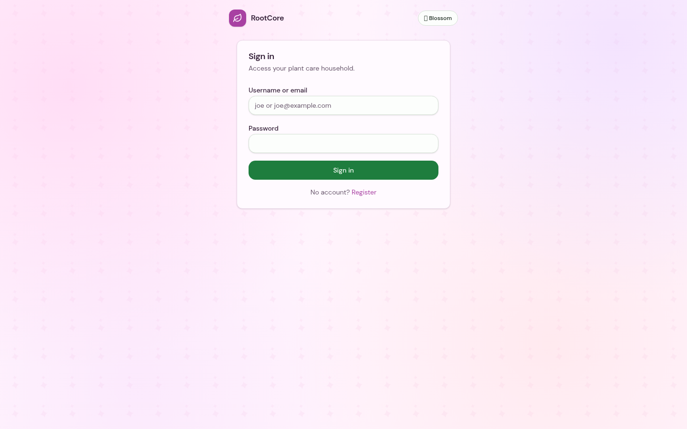
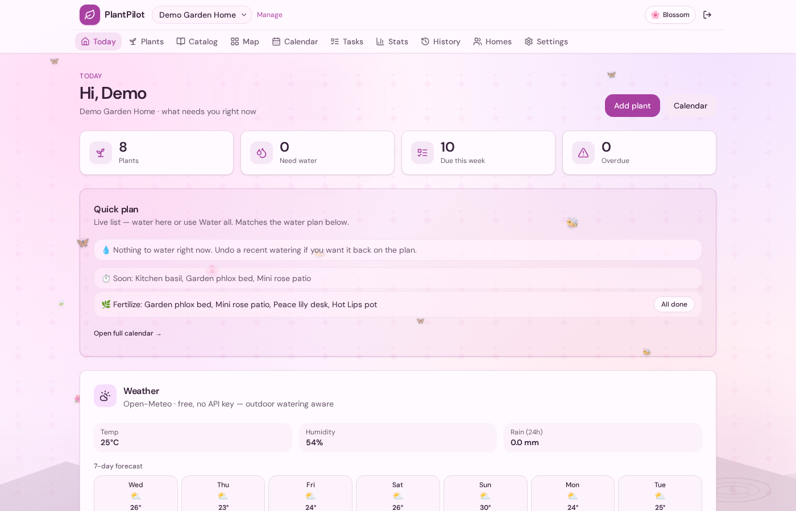
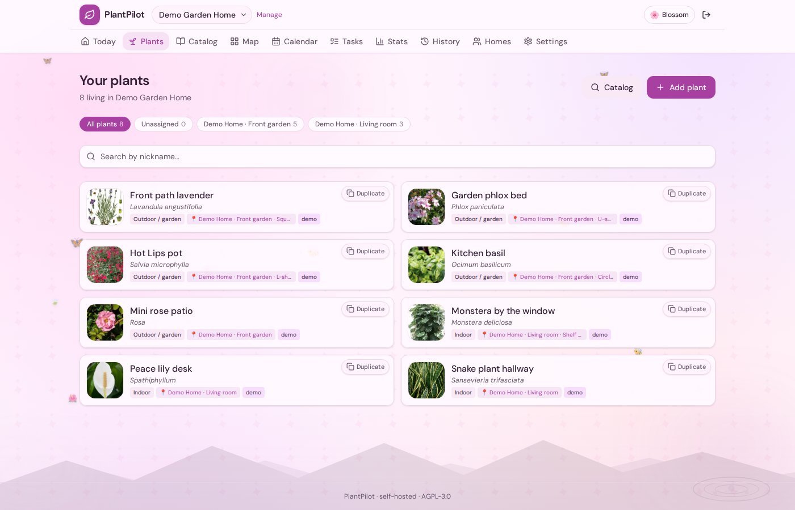
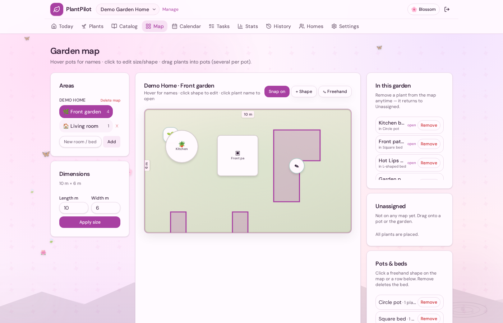
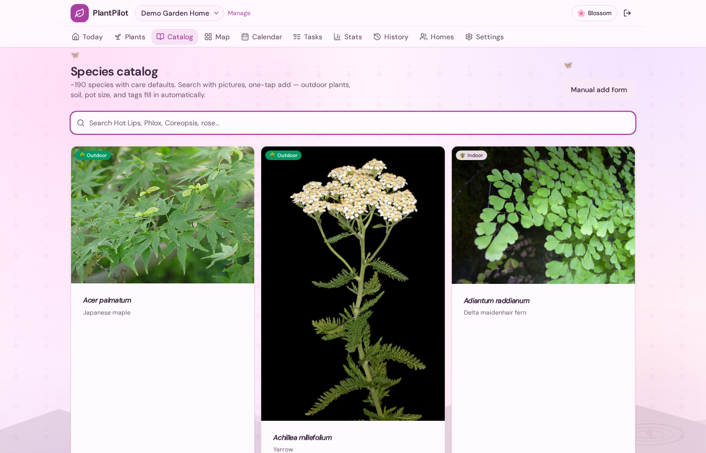

# RootCore

Self-hosted plant care. Watering intelligence, garden maps, shared homes, and a calm UI. Your data stays on **your** machine.

**[GitHub](https://github.com/Username-010/rootcore)** · **[Integrations](INTEGRATIONS.md)** · **[Changelog](https://github.com/Username-010/rootcore/blob/main/CHANGELOG.md)**

## 0.2.0 — sensors & integrations

Connect real Home Assistant soil channels (humidity, temperature, battery) to existing plants. History graphs use HA recorder timestamps. Tuya / LocalTuya / ESPHome / Zigbee are supported **through Home Assistant**, not as fake native cloud adapters. Tokens stay on the server.

## Screenshots





| Plants | Map | Catalog |
|:---:|:---:|:---:|
|  |  |  |

## Run

```bash
git clone https://github.com/Username-010/rootcore.git
cd rootcore
cp .env.example .env
docker compose up -d --build
```

App: http://localhost:8000

## Menus and iPhone alerts

Today, Find care, Plants and Tasks stay in the main bar. Everything else is under **More**, grouped as Care, Jobs, Grow and Home.

iPhone alerts: open **https://rootcore.home** in Safari (install the homelab CA if needed), Share → Add to Home Screen, open the icon, then Settings → Enable browser notifications. This is not an App Store app.
